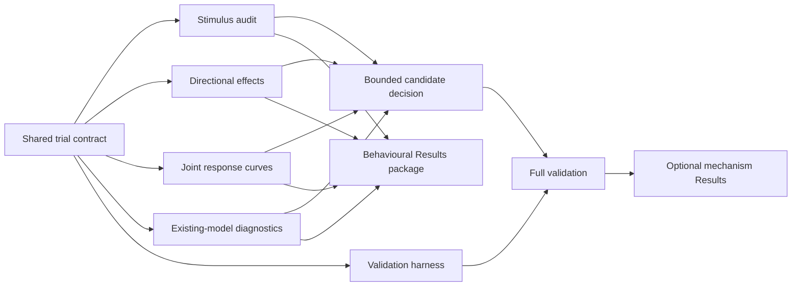

# Plan: existing-data pulse follow-up, with parallel agent workstreams
Status: active
Created: 2026-10-23 by Codex
Related reports: [research synthesis](../../dissemination/reports/pulse-thesis-research-2026-10-23.md), [research handover](../reports/2026-10-23-pulse-thesis-research.md), [amendment 6 result](../reports/2026-10-23-amendment-6-result.md)
Parent: [paper write-up](2026-10-20-paper-writeup.md)

**Phase: implementation (launched 2026-10-23 by Claude Opus 5.5 as coordinator).** Run ID `20261023T191030Z_fa8de8b`, contract config v2 (`/mnt/data/processed/pulse_followup/20261023T191030Z_fa8de8b/data/analysis_config.json`). Authorized scope: A–E plus the behavioural Results package in H; present the diagnostic recommendation (F1) to the user before F/G. No cluster jobs or installs. This is the source of truth for the follow-up, not a replacement for the historical primacy protocol.

### Assignment record (coordinator)

| ID | Owner | Started (UTC) | Completed (UTC) | Output |
|---|---|---|---|---|
| A | Coordinator (Claude Opus 5.5) | 2026-10-23 ~18:40 | 2026-10-23 19:10 | `<run>/data/`, reports/2026-10-23-pulse-data-20261023T191030Z_fa8de8b.md |
| B | Worker 1 (subagent) | 2026-10-23 19:13 | 2026-10-23 19:56 | `<run>/stimulus/`, reports/2026-10-23-pulse-stimulus-20261023T191030Z_fa8de8b.md | |
| C | Worker 2 (subagent) | 2026-10-23 19:13 | 2026-10-23 19:22 | `<run>/behaviour/`, reports/2026-10-23-pulse-behaviour-20261023T191030Z_fa8de8b.md | |
| D | Worker 3 (subagent) | 2026-10-23 19:13 | 2026-10-23 19:21 | `<run>/response_time/`, reports/2026-10-23-pulse-response_time-20261023T191030Z_fa8de8b.md (D1 accepted) | |
| E | Worker 3 (subagent, continued) | 2026-10-23 19:21 | 2026-10-23 22:04 | `<run>/diagnostics/`, reports/2026-10-23-pulse-diagnostics-20261023T191030Z_fa8de8b.md | |

## Goal

Using existing data, quantify how scheduled pulses affect response direction, latency and response probability, and determine which aspects the existing models cannot explain. Deliver a useful pulse Results section even if additional modelling cannot distinguish mechanisms. Attempt a narrowly bounded mechanism comparison only after the stimulus and behavioural diagnostics justify it.

## Context

- The original and revised primacy gates failed; the confirmatory procedure is closed under amendment 6 item 8. Its calibration concerns that particular procedure, not every possible pulse analysis. Preserve its results and stopping decision.
- New analyses are **exploratory**, including analyses using cross-validation. Existing outcomes have informed the project; retrospective CV does not restore confirmatory status.
- Both replay implementations change noise-dot directions on return to baseline. Removing the average pulse component is not a physical no-pulse replay. The consequences are unmeasured; this does not establish that behavioural effects are artefacts.
- Use scheduled assignment, not RT-dependent `pulse_type`. Retain censoring and responses before a scheduled pulse in the assignment analysis. Rig and mouse cohort are confounded.
- The research synthesis contains the evidence, literature, feasibility inventory and runtime anchors. Do not turn its feasibility counts into results or power estimates.

## Assumptions

- Existing processed inputs, task/replay code, stored predictions and fits remain accessible. No new behavioural collection is available.
- Four concurrent agents is a practical default: one coordinator and three workers. More agents can implement independent later modules, but cannot bypass scientific dependencies.
- Assignment randomization, availability of pre-treatment timing metadata, and reconstructability of the physical stimulus still need verification. Causal wording depends on those checks.
- A first behavioural package may take about one working day; a validated mechanism follow-up may take roughly 4–7 working days plus queue time. These are planning estimates, not commitments or measured new runtimes.

## Steps and ownership

All implementation steps remain unchecked until their acceptance criteria are met. The coordinator records named owners and UTC start/completion times here. Each worker owns its code and report; only the coordinator edits this plan, STATUS, shared data contracts and manuscript integration while workers run.

| ID | Work package | Default owner | Required inputs | Handoff |
|---|---|---|---|---|
| A | Trial table, assignment audit, analysis contract | Coordinator | Existing inputs and metadata | Frozen table, exclusions, schema, configuration |
| B | Physical stimulus and ME audit | Worker 1 | A metadata; replay code inspection can start immediately | Replay comparisons, interpretation limits |
| C | Directional behavioural effects | Worker 2 | A frozen table/config; D1 only for optional control contrasts | Per-mouse effects, uncertainty, figures |
| D | Pulse-aligned joint response distributions | Worker 3 | A frozen table/config | Left/right/no-response curves and diagnostics |
| E | Existing-model failure diagnosis | First free worker | A; existing fits; C/D summaries for interpretation | Likelihood profiles and mismatch report |
| F | Candidate selection and implementation | Coordinator selects; Worker 1 implements | B, C, D, E | At most one targeted extension and matched comparator |
| G | Simulation and validation | Worker 2 | Harness can start after A; final runs require F | Recovery, confusion, coverage and sensitivity |
| H | Independent checks, integration and writing | Coordinator + free reviewer | A–E for behavioural package; F/G only if completed | Traceable Results, figures, limitations |

The first parallel wave is B/C/D. Reuse the first free worker for E; do not wait for every stimulus question to resolve before describing the observed behaviour. A basic validation harness can be prepared independently. New mechanism fits depend on B–E and must not start speculatively.

### A. Shared trial table and analysis contract — coordinator

- [x] A1. Read current STATUS, this plan, the research synthesis and the amendment 6 result. Snapshot commit, dirty tracked diff hash, environment versions and input hashes. Confirm paths before running commands; processed data currently live under `/mnt/data/processed/`.
- [x] A2. Create a read-only loader joining `ddm/ddm_inputs_global.npz`, `valid_data.csv`, `censored_trials.csv` and existing aggregate/task metadata by verified unique trial identity. Locate the actual files; do not rerun the original builders, whose defaults may overwrite outputs.
- [x] A3. Audit scheduled pulse sign/onset, exclusions, assignment rules and within-session balance. Distinguish source-code evidence of randomization from merely balanced counts. Record which schedule fields were assigned before the response and which are measured after stimulus presentation.
- [x] A4. Write the versioned trial table, schema, exclusion ledger and frozen configuration. Verify against the DDM input mask and the responded-only inventory in the research report; reconcile rather than force any discrepancy. Set an explicit `ready_for_behaviour` flag only after checks pass.

Required columns: unique trial ID/`agg_code`; mouse; mouse-session ID; rig; seed; nominal coherence in a declared unit; scheduled pulse category/sign; scheduled onset and its provenance; recorded onset/offset/duration separately; frame-quantized timing; response side; observed response RT; event indicator; administrative follow-up deadline; pre-onset response indicator; inclusion flags/reasons; source-row identifiers. Store missing metadata explicitly. Distinguish a genuine pulse replacement from pulse coherence equal to baseline.

**Censoring contract:** the existing analysis uses a 5 s deadline. In the censored CSV, `reaction_time = 5` can be a replay placeholder, not a response at 5 s. Use the authoritative censor flag: retain these trials as unresponded at the deadline, preserve original RT separately if available, and never manufacture an event. A left response is a competing event for a right response, not independent censoring.

**Default analysis set:** retained DDM input trials, including censoring, to maintain comparability. Primary directional contrast uses `abs(base_coherence) <= 0.36`; all retained coherences and zero nominal coherence are declared sensitivities. Record this as a new exploratory design choice. Do not silently transfer it to the historical protocol. A broader behavioural set, if needed, gets a separate ID and exclusion ledger.

**Strata and weighting:** use mouse × session × nominal coherence × preassigned onset stratum for positive-versus-negative comparisons. UW has its discrete schedule; UCLA uses the existing onset-bin boundaries at 0.16 and 0.32 s, provided these represent available pre-treatment schedule metadata. If only measured onset is available, flag the timing limitation and use a clearly labelled descriptive timing stratum. Freeze this decision using metadata before looking at new effect estimates. Keep cells with both signs; weight cells within each mouse by `min(n_positive, n_negative)` and normalize to one. This estimates an explicit common-support population, not all trials. Report retained/excluded counts and coverage for every mouse; no outcome-driven merging of sparse cells.

Save a single `analysis_config.json` declaring analysis sets, strata, estimands, deadline, time grid, random seeds, inference family and output schema. Downstream agents must use this contract. If it changes, increment its version and invalidate affected outputs explicitly.

### B. Physical stimulus and motion-energy audit — Worker 1

- [x] B1. Inspect `scripts/ucla_rdk.py`, `scripts/uw_rdk.py`, `scripts/compute_motion_energy_full.py`, `scripts/ddm/build_ddm_inputs.py` and `scripts/ddm/primacy.py::no_pulse_frames`. Record timing/frame conversion and modal-duration assumptions.
- [x] B2. Select a reproducible metadata-only subset spanning both rigs, pulse signs, nominal coherences, onset strata and recorded durations. Replay each initial seed with its pulse and with the pulse event physically omitted. Include enough independent seeds to show the distribution, not a single illustrative trace.
- [x] B3. Verify pre-onset identity of rendered frames and measure signed and unsigned ME differences during and after the pulse. Audit filter causality and timestamp conventions separately; acausal filtering or centring can spread an ME difference before the physical onset. Compare the physical omission with the current average-component subtraction. State random-number coupling: equal initial seeds do not guarantee equal future random draws after branches consume different draws.
- [x] B4. Audit UCLA freeze provenance, pulse durations, spatial pooling and filter shape. If acquisition records cannot establish the correct freeze timing, retain labelled alternatives as sensitivity inputs; do not call a preferred replay verified.
- [x] B5. Deliver a stimulus report, machine-readable summaries and representative traces. Recommend whether a new full replay is necessary and estimate its cost from a measured small subset. Do not overwrite existing ME or launch full recomputation automatically.

Acceptance: pre-onset rendered-frame differences are zero within a documented numerical tolerance or their cause is resolved; filter-induced timing shifts are documented; post-offset ME differences are quantified, including whether they align systematically with pulse sign. A nonzero absolute difference alone does not establish a directional bias or explain the behavioural effect. Distinguish verified rendering facts, unknown acquisition facts and downstream hypotheses.

### C. Directional pulse effects — Worker 2

- [x] C1. Compute standardized right, left and unresponded probabilities by deadline for positive and negative scheduled pulses in A's common-support cells. Keep responses before scheduled onset. Report all mouse-level contrasts and coverage.
- [x] C2. Estimate the declared group directional contrast with mice weighted equally, not trials. Show component changes in right, left and unresponded probabilities so a response-rate change cannot masquerade as a pure choice shift.
- [x] C3. Run declared robustness checks: all coherences; zero nominal coherence; leave-one-mouse-out; session stability; and matched-seed comparison where both signs actually exist. The research inventory found matched signs in UCLA but not UW; do not invent matched UW controls or treat seeds/sessions as independent mice.
- [x] C4. Add pulse-versus-control contrasts only on justified common support. For timing-matched controls, use D's frozen control-onset rule. Deliver estimate tables, figures and a short interpretation with limitations.

For each mouse define `Delta_R = P(R by 5 s | positive) - P(R by 5 s | negative)`, and similarly `Delta_L`. Primary endpoint: `Delta_direction = (Delta_R - Delta_L) / 2`, expressed in percentage points. This is a symmetric directional probability contrast, **not** accuracy or the fraction of right choices among responders. Also report `Delta_unresponded`; all three component contrasts must sum to zero. Average per-mouse endpoints for the group estimate.

Default group uncertainty: a two-sided 95% Student-t interval across independent mouse estimates, with its small-sample/shape assumptions stated and all mouse points visible. A mouse-level bootstrap interval and leave-one-mouse-out estimates are sensitivity checks, not guarantees with this sample size. Check interval behaviour in G's behavioural simulations. Do not report trial-level standard errors as group uncertainty. Any reported p-values for the primary and two planned pulse-versus-control directional contrasts form one Holm-corrected family; record which contrasts were estimable. Other stratified findings are descriptive with pointwise intervals, without a search for significant subsets.

Causal language requires A to support randomized, unannounced assignment with comparable pre-onset exposure and to rule out material selection from treatment/outcome-dependent exclusions. Otherwise describe adjusted associations. Never use realised RT, post-pulse ME, or trial-average ME containing the pulse as a baseline adjustment. A responder-only logistic regression is optional and secondary, accompanied by response probabilities and its selection caveat.

### D. Pulse-aligned joint response distributions — Worker 3

- [x] D1. Freeze the control alignment and time grid before viewing contrasts. Prefer recorded sham onsets. Otherwise assign one pseudo-onset per control using a fixed-seed draw from the schedule distribution within mouse/session/coherence, independent of future response; if support is inadequate, omit that comparison. Repeat pseudo-onset seeds as sensitivity, not as extra observations.
- [x] D2. Produce two explicitly distinct summaries: all scheduled trials, and trials unresponded immediately before onset. For the all-scheduled curves retain accumulated pre-onset response mass; for the onset-eligible curves start with zero response mass at onset.
- [x] D3. Estimate standardized cumulative incidence of right and left responses and probability still unresponded, by rig-specific onset stratum and elapsed time. Begin with empirical cell-weighted curves using A's support rules, not a large new regression model. Use matched common support for control contrasts.
- [x] D4. Report response-direction changes, any common latency/response-rate effect of both pulse signs, and uncertainty across mice. Overlay existing simulations only where their schedule and inclusion rules match. Deliver curves, risk counts, contrast tables and a diagnostic summary for E.

Respect each trial's remaining follow-up `5 s - onset`; do not extend its curve with fabricated observations. Use a common supported time range within each comparison, or explicitly handle administrative censoring. Required checks: cumulative incidence is nondecreasing, probabilities stay in [0,1], and `CIF_left + CIF_right + survival = 1` on the supported grid. Show the number of eligible mice and trials, not just the initial total.

Onset eligibility can support a causal contrast only under verified unannounced assignment and identical pre-onset exposure. It does not identify one invariant integration window across onset strata. Post-pulse hazards condition on treatment-affected survival. Late cumulative differences can carry forward an earlier effect. An `RT >= onset + 0.5 s` plot, if included, is an explicitly selected descriptive sensitivity, never the main evidence of memory retention. Do not perform the closed confirmatory timing test here.

### E. Diagnose the existing model — first free worker

- [x] E1. Read final control fits, revised pulse-gain fits and saved held-out predictions. Preserve fold membership; label any new gain-profile fit as exploratory/in-sample or held-out as appropriate. Confirm predictions and empirical summaries use the same mask and schedule.
- [x] E2. Decompose the existing `CensoredQMLE` objective into its three-outcome count term and conditional choice-specific RT-bin terms, preserving smoothing, bins, empty-cell penalties and weights. Verify their sum reproduces the original objective on fixed predictions. If splitting choice from response/censoring, use the chain rule on the same smoothed three-category probabilities, not separately re-smoothed objectives.
- [x] E3. Profile pulse gain and compare the diagnostic choice-only optimum with the joint optimum. Plot directional probabilities, correct/error RT distributions and censoring against gain. Do not change likelihood weights to improve a preferred conclusion.
- [x] E4. Assess whether failures are consistent with pulse amplitude/shape, common latency effects, or known control psychometric errors. Check fold/seed stability and Monte Carlo variability. Distinguish a demonstrated choice–RT tradeoff from a suspected one.
- [x] E5. Deliver a ranked mismatch report with one falsifiable candidate recommendation, or recommend stopping modelling. Include expected behaviour on controls and the smallest useful simulation benchmark.

No full refit of shared control parameters in E. If frozen-parameter uncertainty seems important, propose its treatment in F and include its computational cost. Leak and urgency were already present in the secondary baseline; simply repeating those additions is not a new diagnostic result.

### F. Select and implement a bounded candidate — after B–E

- [x] F1. (2026-10-23: user chose the reduced tau_p pilot with corrected inputs first; see Log) Coordinator writes a dated decision using B–E. Choose **one** branch below or stop with the behavioural/model-limitation result. Record predicted improvements and an observable result that would disconfirm the candidate.
- [x] F2. (frozen: <run>/models/f2_spec_tau_pilot.json, sha256 4c1995ca…; committed before any pilot evaluation) Freeze equations, parameter bounds, shared-versus-mouse parameters, control treatment, train/test folds and the new comparison rule. Archive this specification before evaluating the new comparison, while retaining its exploratory label.
- [ ] F3. Implement the candidate and the comparison with matched sensory flexibility. Run a representative local benchmark; prepare exact cluster commands, job count, resources and budget. Cluster submission needs user authorization under AGENTS.md; preparing code and commands does not authorize submission.

Branches, in priority order conditional on findings:

1. Misrepresented sensory pulse: corrected physical input with pulse gain; at most one additional pulse-response time constant if the input audit supports it. Avoid double-counting the existing ME filter delay.
2. Shared latency effect for both directions: one specified pulse-triggered response/engagement component. An additive nondecision delay must not be presented as explaining directional shifts by itself.
3. Adequate sensory/response model but residual temporal discrepancy: one specified memory/leak or evidence-weighting extension. State how it differs from the already tested leak/urgency baseline and how it will be distinguished from sensory persistence.

At most three candidate families: reference accumulator, the one targeted extension, and a matched short-memory/extrema comparator when strategy discrimination is the question. Do not simultaneously add a flexible sensory kernel, leak, urgency, variable delays and latent states. A numerical correction to the input belongs equally in both strategy families.

Prefer held-out sessions where each training/test partition retains necessary conditions. Add grouped repeated-seed holdout where feasible; inspect whether seed/session overlap makes both exclusions possible. If it does not, report the exact generalization target rather than claiming both. All outcome-derived preprocessing, parameter fitting and tuning stay inside training folds. A joint control/pulse refit is a new model and must retain held-out control adequacy as well as pulse adequacy.

### G. Simulation, discrimination and stopping — Worker 2

- [x] G1. (done 2026-10-23 by Worker 2; validation/g1/, reports/2026-10-23-pulse-validation-g1-20261023T191030Z_fa8de8b.md) Build a harness against A's actual design before F is ready. Include null/directional-effect generators to check C/D estimands, exclusion rules, probability conservation and interval behaviour. Test a pulse after the response, censoring, and a known time-local perturbation.
- [ ] G2. After F is specified, simulate every candidate, including competing sensory and decision explanations. Reproduce observed schedules, censoring, folds, eligibility and the full selection procedure. Refit every parameter the proposed real analysis fits; do not hold control parameters fixed if F refits them.
- [ ] G3. Run a fixed pilot of 20 datasets per declared scenario to detect coding failures or gross nonidentifiability. Report Monte Carlo intervals. This pilot cannot certify calibration; stop expansion if it clearly cannot resolve the intended claim.
- [ ] G4. If feasible, freeze a final simulation budget and thresholds before new real-data comparison. Proposed final target: at least 200 null datasets and 200 per key alternative scenario, subject to a measured compute estimate and separately authorized jobs. Report uncertainty rather than silently reducing the count or ignoring inconclusive rates.
- [ ] G5. Deliver model-confusion matrices, null selection rates, effect/parameter recovery, interval coverage and sensitivity curves over prespecified plausible values. Classify each proposed claim as supported by validation, conditional, or unresolved.

Proposed operating requirements, to be frozen in F2/G4: calibrate the overall selection rule to a nominal 5% null false-positive rate and report its binomial interval; a 95% upper endpoint above 10% is insufficient assurance for a mechanism claim. For a strong discrimination claim, require the lower 95% binomial bound on correct discrimination to exceed 80% at the declared scientifically meaningful scenarios for each relevant candidate. These are new conservative project criteria, not established properties of the old protocol. Do not selectively remove hard but plausible scenarios. If the available budget cannot establish these criteria, retain a predictive comparison with appropriately limited wording or an unresolved conclusion.

No-effect claims require sensitivity to a stated meaningful effect; a nonsignificant coefficient is insufficient. Parameter interpretation requires satisfactory recovery/coverage, not just predictive improvement. A well-predicting but nonidentifiable pair of sensory/decision time constants cannot be reported as a unique integration time constant. No repeated model expansion after a failed comparison within this plan.

### H. Verification and paper/thesis handoff — coordinator and reviewer

- [ ] H1. Integrate A–E as soon as they are ready: per-mouse directional effects, joint response curves, and observed-versus-predicted failures. An unresolved stimulus issue can be reported explicitly rather than blocking descriptive behavioural writing. This is the minimum useful deliverable; it does not depend on F/G succeeding.
- [ ] H2. (C: checked by coordinator, VERIFIED; D: Worker 2, all 6 items PASS, reports/2026-10-23-pulse-review-D-20261023T191030Z_fa8de8b.md; B: coordinator spot check of the rounding shift VERIFIED; E: coordinator spot check of e3_optima (PSUIM6 w_choice 7.0 vs w_joint 2.45; choice gain 9.3, RT cost 97.6 NLL) VERIFIED) A worker who did not author a module checks its masks, units, support, censoring, standardization and one independently recomputed summary. Check that no analysis conditions on post-pulse RT while claiming an unselected causal effect.
- [ ] H3. Add optional F/G results only with their validation and exploratory status. Keep original and revised gate failures visible. Distinguish evidence favouring accumulation over the tested control alternative from unique pulse-mechanism identification.
- [ ] H4. Draft versioned Results, Methods and captions with every number linked to a saved table and reproduction command. Include effect sizes, group uncertainty, declared correction, exclusions and unresolved stimulus/model limitations. Update provenance, plan and STATUS.
- [ ] H5. Verify no original input, frozen prediction, result or historical protocol was overwritten. Mark this plan done only when the chosen scope and all necessary validation are complete; explicitly record a scientific stop in F/G rather than implying unfinished modelling succeeded.

## File boundaries and handoff contract

The following are **proposed new paths**, not files already implemented:

| Owner | Exclusive code paths under `scripts/pulse_followup/` |
|---|---|
| Coordinator/A | `__init__.py`, `data.py`, `config.py`, `io.py`, `inputs_v2.py` (corrected DDM inputs) |
| B | `stimulus_audit.py` |
| C | `behaviour.py` |
| D | `response_time.py` |
| E | `diagnostics.py` |
| F | `models.py`, `fit.py` |
| G | `validation.py`, `checks.py` |

Use existing dependencies; do not install packages. Use `.venv/bin/python -B` with `PYTHONDONTWRITEBYTECODE=1`. Each script should expose `--help`, require an explicit run directory and refuse to overwrite completed outputs. Keep existing simulator/likelihood/replay modules unchanged unless the coordinator assigns a specific reviewed change. Audit wrappers can call their existing interfaces. Do not concurrently edit notebooks or main paper captions.

One coordinator-created run ID: `YYYYMMDDTHHMMSSZ_<commit>`, with a manifest also recording the dirty diff hash. Outputs go to `/mnt/data/processed/pulse_followup/<run_id>/{data,stimulus,behaviour,response_time,diagnostics,models,validation}/`. Figures go to `dissemination/paper/figures/pulse_followup/<run_id>/`, with stage-prefixed names. Each worker writes its own `.agents/reports/YYYY-MM-DD-pulse-<stage>-<run_id>.md` and stage manifest. The coordinator consolidates status updates; no worker overwrites another worker's report or marks their steps complete.

Each handoff must contain: code/source snapshot with content hashes for used code, including untracked files; input/config hashes; exact command; dependency versions; seeds/folds; analysis-set ID; machine-readable output paths; checks performed and failures; measured runtime; verified findings versus hypotheses; limitations; next dependency. Publish a completion marker only after outputs and validation are complete. A missing check is an unfinished step, not an implicit pass.

Worker start instruction: “Read AGENTS.md, STATUS and this plan. Implement only package <ID> in its owned files. Use the frozen A contract; report needed contract changes to the coordinator. Do not submit jobs, change the original primacy protocol, or infer a mechanism from a descriptive timing curve. Return the stage manifest and report before taking another package.”

## Suggested schedule and stopping points

- **First 1–2 hours:** coordinator builds/finalizes A; B inspects replay code and chooses metadata-only subset; C/D scaffold their modules against the proposed schema. Behavioural computation waits for A's ready marker.
- **Remainder of first working day:** B/C/D in parallel; start E on the first available worker. Aim for the first directional-effect and joint-response figures, with uncertainty and limitations. No promise of statistical significance or a full mechanism result that evening.
- **Following 0.5–1.5 working days:** finish replay and failure diagnostics; coordinator chooses F or records a stop. H can already produce a behavioural Results draft.
- **Optional follow-up:** roughly 1–2 working days for a candidate and 1–3 for validation, plus compute/queue time. Benchmark before requesting jobs. More workers shorten independent coding, not sequential identification checks or cluster queues.

Stop at a quantified behavioural perturbation and a model limitation if stimulus reconstruction remains ambiguous, diagnostics do not motivate a falsifiable extension, or calibration cannot distinguish candidates. Report those limits; do not reinterpret them as absence of accumulation or primacy.

## Out of scope

New data collection; reopening the historical confirmatory test; retuning its thresholds; running all proposed mechanism extensions; assigning a unique neural mechanism from a good fit alone; unrelated model/ME robustness projects; changing raw data; overwriting fits/predictions; package installation; cluster submissions without authorization; sending unpublished data to external services.

## Log

- 2026-10-23: User requested an implementation plan suitable for parallel agents, following the existing-data research review. Created this child plan because the parent writing plan excludes running analyses and the closed primacy protocol must remain intact. Drafting only in this pass; all implementation steps unchecked. Proposed estimands and new validation criteria must be frozen before the corresponding follow-up comparisons, and remain exploratory.
- 2026-10-23 (Claude Opus 5.5, coordinator): implementation launched by the user ("implement ... act as coordinator, parallel subagents"). A done; see the A report. Deviations and findings that change the contract:
  - Task source code supplied by the user mid-session (NeuRPi rt_pulse, RDK-Task); read at HEAD commits fcfb603 / 6fb3878. Assignment is VERIFIED randomized from source (UW independent per-trial draws given coherence; UCLA permuted blocks, 12.5% per pulse category), not only balanced counts. Caveat: HEAD may postdate collection.
  - UCLA onset: scheduled draw N(60,15) / N(240,15) ms; recorded BurstTime is the applied time. Strata named early/middle (as sched_pulse_type), provenance `scheduled_category_measured_time`, not a descriptive proxy.
  - Label bug in existing DDM inputs (affects existing results slightly): 48 UCLA no-response pulse trials have pulse_coherence NaN (notebook 0.0 derives direction from the response-dependent target) and were labelled controls. 43 recovered via sign(BurstCoh*coherence) (38 genuine, 5 null); 5 at 0% have unknowable direction (`pulse_direction_unknown`). Not corrected in the existing inputs or the closed procedure.
  - The 15 trials the DDM builder dropped (missing/invalid duration) are responses during the UCLA pulse (burstEndTime not refreshed): outcome-dependent exclusion, ledgered. Durations of other UCLA trials that responded within 50 ms of onset may be stale (flag `response_before_pulse_end`).
  - UW schedules one |coherence| per session (18% in 12 sessions, 36% in 6) with rightward middle/late pulses and late shams only. Contract v2 adds `signs_scheduled_symmetric`; pulse-vs-control contrasts are restricted to symmetric cells. On symmetric cells sign balance holds in both rigs.
  - UCLA controls have no sham time: pseudo-onsets assigned in A (fixed seed, session x |coherence| pools); D1 confirms or proposes a versioned change.
  - Runs 20261023T190809Z (failed check, too strict), 190856Z and 191004Z (config v1) were superseded before release; each carries SUPERSEDED.json.

- 2026-10-23 19:22 (coordinator): D done (D1 accepted, no rule change). D design choices accepted as documented: (a) onset-eligible summaries re-apply A's weighting to eligible trials; (b) three-arm comparisons weight by min of the three arm counts; (c) UCLA pseudo-onset pools by |coherence| (UCLA blocks assign bursts independently of sign). C done; C4 ran after D1. E assigned to Worker 3 (continued); H2 review of D assigned to Worker 2 (continued).
- 2026-10-23 (coordinator H2 check of C): independent recomputation from the frozen table (own code, plain loops) reproduces primary Delta_direction 5.844 pp, t CI [1.799, 9.889], and all 10 per-mouse values. VERIFIED. C and D agree (D all-scheduled +5.80 at onset+4.58 s; onset-eligible +5.85). Post hoc asymmetry row in C (pos-vs-control minus control-vs-neg) is descriptive only; do not claim.
- 2026-10-23 (coordinator): H2 review of D by Worker 2 passes all items; numbers unchanged. Minor: curves.csv.gz interval columns lack a method label (fix in any later version; no rerun). C-vs-D gaps explained by horizon (118 responses between onset+4.58 s and 5 s) and onset eligibility.
- 2026-10-23 (coordinator): G1 (behavioural harness for C/D estimands: null, known delta 3/6/10 pp, post-response pulse, censoring, time-local perturbation; coverage/null rate/power with MC intervals) assigned to Worker 2. Justification: the plan requires checking C's interval behaviour in G's simulations before the H Results; G2-G5 stay deferred until the user decides on F.
- 2026-10-23 19:35-19:51 UTC: all three workers (B, E, G1) stopped on an account API session limit; resumed at 19:51 from saved state. B's replay subset had finished at 19:30; E and G1 had produced no outputs.
- 2026-10-23 (coordinator): B done (7/7 checks). Key facts for F1: no sign-aligned post-pulse stimulus bias beyond a deterministic one-dot rounding shift (UCLA +0.198%, UW +0.658% coherence in specific coherence x sign cells; independently reproduced by coordinator from scripts/{ucla,uw}_rdk.py); DDM average pulse component close to physical mean; UCLA pulse energy possibly understated x1.28-1.40 if the rig had no freeze (labelled alternative; loop rate/lifetime/monitor unknown). UW replay applies pulses one move early relative to NeuRPi (energy ratio 1.006). Full replay not needed for behavioural interpretation; optional UCLA-only sensitivity replay ~25 core-hours (not run; needs approval). B's proposed contract additions (rounding-shift column, UCLA 0% true sign) deferred: not needed for C/D; available in stimulus/dotstate_all_pulse_trials.csv.
- 2026-10-23 (coordinator): G1 done (200 datasets/scenario, 105 s). C/D Student-t intervals adequate (coverage 0.93-0.975; null rejection 0.025 [0.008, 0.057]; Holm family any-rejection 0.030). Mouse bootstrap undercovers (0.85-0.93): report it only as a labelled sensitivity, never as the primary interval. Power of Holm-adjusted primary at delta = 6 pp is 0.64 [0.57, 0.71]; at 3 pp 0.21. Assumes normal between-mouse spread, control-based outcomes, independent trials.
- 2026-10-23 (coordinator): H1/H4 behavioural Results draft written to dissemination/paper/pulse_followup_results_2026-10-23.md (new versioned file; manuscript_2026-10-23.md and figure_captions.md not edited). Numbers taken from saved tables (behaviour/group.csv, response_time/contrast_table.csv) with notes to sources. E section pending. Newly noted, uncorrected: three-arm common_cif_L@4.58 = -2.3 pp [-3.9, -0.7] (all-scheduled), same asymmetry as pos-vs-control > control-vs-neg; SUSPECTED only.
- 2026-10-23 (coordinator): verified that the 38 mislabelled UCLA genuine pulse trials also lack the pulse in the stored ME (sign-aligned peak -0.26 vs 24.75 % coherence in normal censored pulses): label and stimulus both 'no pulse' in ddm_inputs_global.npz. Existing-input UCLA censored fraction pulse 16.0% vs corrected 16.4%; controls 16.7% vs 16.4%. Decision on a versioned corrected input (v2) deferred by the user until E is done; coordinator recommendation: document now, build v2 only if F proceeds.
- 2026-10-23 (coordinator): E done (COMPLETE, no failing checks; first attempt superseded for an over-strict 1e-6 GPU-vs-CPU profile tolerance, relaxed to 0.5 NLL; results identical). Ranked: (1) timing of the directional effect: model early then reversing (2-4.58 s: -2.98 pp [-4.21, -1.75] at choice-only gain; -1.44 at stored gain; leak+urgency baseline also reverses), data delayed and sustained; choice-RT tradeoff demonstrated in PSUIM6/7 only, suspected in 6-7 mice, not supported in DBM14; (2) required gain 2-7x exceeds B's physical bound x1.4; (3) coherence-slope excess on pulse trials (0.156 logit) matches the control fit's own misfit (0.158); pulse-specific residue ~0.08-0.11 logit; (4) no common latency burst (branch 2 not supported). Commit moved fa8de8b -> 475934e during E: user's own commits (final fits, fit-quality figure), not pulse follow-up work.
- 2026-10-23 (coordinator): F1 recommendation pending the user's decision. E proposes one branch-1-form candidate (causal exponential pulse time constant tau_p, gain and control parameters frozen); full benchmark ~1.8 CPU-h (PSUIM6/7, 5 tau x 23 gains), reduced ~25 min (3 tau x 8 gains). Not run.
- 2026-10-23 (coordinator, F1 decision recorded): the user chose (a) the reduced ~25-30 min tau_p pilot and (b) corrected inputs only because modelling continues. Corrected inputs v2 built: <run>/models/inputs_v2/ddm_inputs_global_v2.npz (30,025 trials; 38 UCLA no-response genuine pulses relabelled and replayed with their pulse; 5 direction-unknown dropped; v1 reconstruction exact to 4e-7; all other rows and templates byte-identical; replayed mean sign-aligned peak 20.9 % coherence). First attempt superseded (compared against a plain no-pulse replay; v1 actually used a NaN-coherence pulse event that still consumes the onset/offset frames).
- 2026-10-23 (coordinator, F2 frozen before any evaluation): <run>/models/f2_spec_tau_pilot.json. PSUIM6/7, primary baseline, tau_p in {0, 100, 300} ms x w in {1, 1.5, 2, 2.5, 3, 4, 5.5, 7}, 50 reps CRN, second-seed check. PASS needs, in both mice: controls unchanged (P0); best tau_p > 0 with >= 10 NLL and > 2x seed-SD improvement plus held-out improvement in >= 4/5 folds (P1); w_choice/w_joint <= 1.5 (P2); late-window model contrast >= -1.0 pp (P3). FAIL or MIXED -> modelling stops; no grid expansion. Exploratory; a pass only motivates full F/G (G2-G5), with user approval.
- 2026-10-23 (coordinator): F3 pilot assigned to Worker 3 (author of E's simulation code) instead of the default Worker 1, to reuse the validated diagnostics machinery; files models.py/fit.py as owned.
