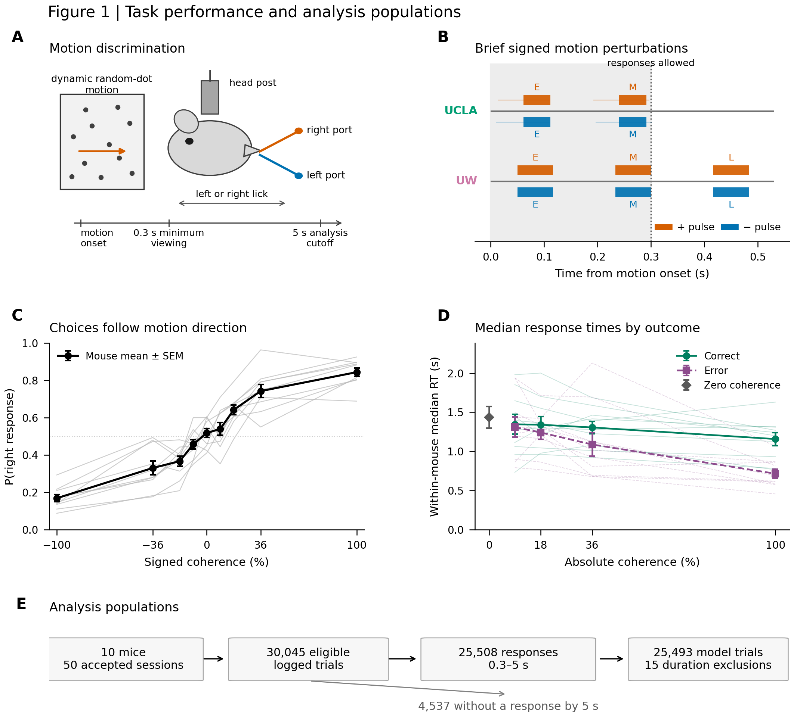
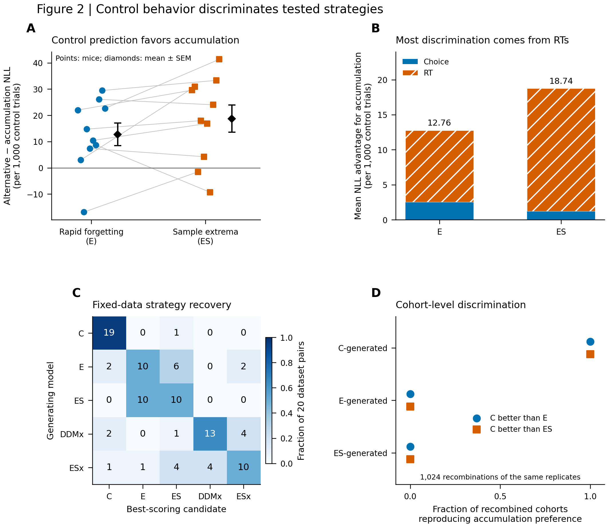
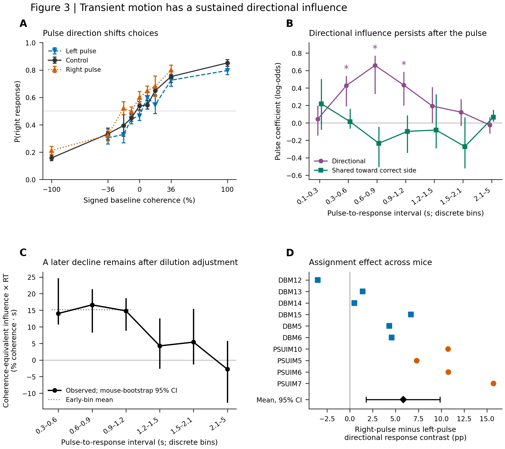
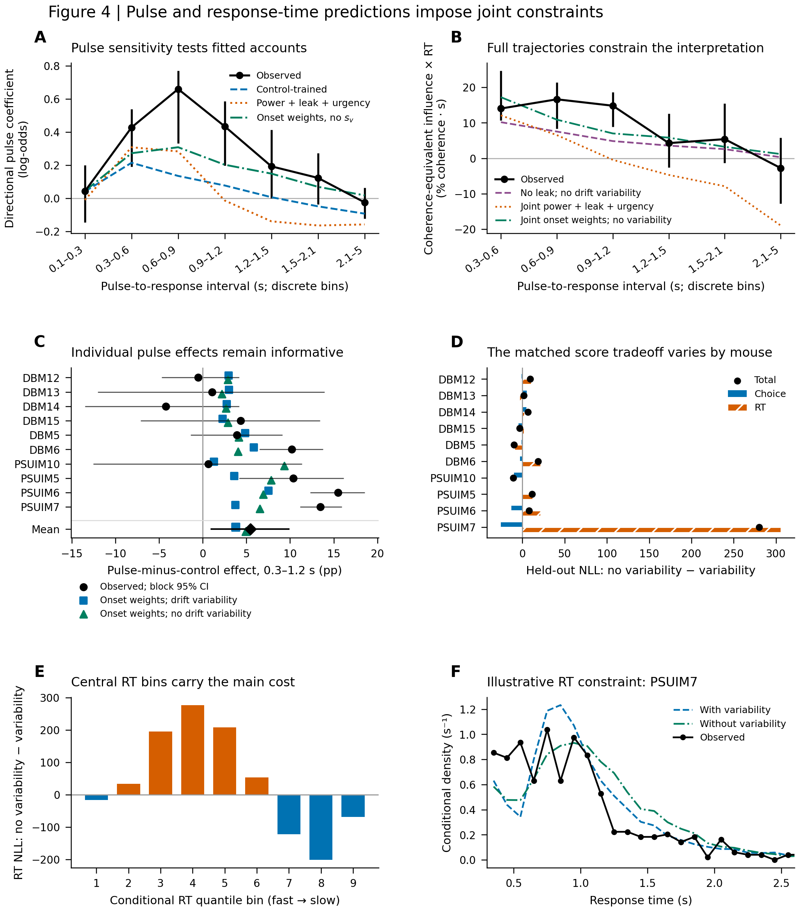

# Mouse motion decisions: figures-first working draft

Draft started 2026-11-15; assembled 2026-11-16. Production order: figures, captions, Methods, Results. Introduction, Discussion and Summary are deferred.

## Figure 1. Mice report motion direction in a reaction-time discrimination task

**(A)** Task schematic. Head-fixed mice reported leftward or rightward random-dot motion by licking the corresponding port. Responses could register after a 0.3-s minimum viewing interval. The 5-s boundary defines the analysis window rather than a common task-termination time. **(B)** Scheduled replacement pulses in the two task implementations. Colored rectangles indicate the median onset and duration of rightward (+, orange) and leftward (−, blue) pulses; thin horizontal lines indicate the observed onset range for the jittered UCLA schedule. E, M and L denote early, middle and late onset categories. Gray shading marks the minimum viewing interval. The schedule panel describes assignments in accepted sessions, including pulses scheduled after a response.

**(C)** Scheduled-control psychometric functions. Thin lines show individual mice; black points and error bars show the unweighted mean and SEM across 10 mice at each coherence. These descriptive curves include 14,015 responded control trials. **(D)** Response times on the same scheduled-control population. Thin lines show within-mouse median response time by absolute coherence and outcome; colored points show the mean and SEM of those medians. A mouse × coherence × outcome cell was displayed if it contained at least 10 responses; all group points contain 10 mice. Zero-coherence trials are displayed separately from correct/error trials. Lines join observed coherence levels for visualization.

**(E)** Analysis populations. Accepted sessions contributed 30,045 eligible logged trials from 10 mice in 50 sessions: 25,508 responses in the 0.3–5-s window and 4,537 trials without a response by 5 s. The latter include responses recorded after the analysis cutoff and trials without a recorded choice. Excluding 15 responded trials with missing or nonpositive pulse-duration information left 25,493 model-input trials. The matched control-model comparison used 14,014 of those trials; its denominator differs from the descriptive control panel by one trial. This flow starts after session selection and does not describe the complete recorded cohort. Source tables: `figures_v5/source_data/fig1_*`; source hashes and population definitions: `figures_v5/figure_manifest.json`.

## Figure 2. Control choices and response times favor accumulation over matched nonintegration accounts

**(A)** Held-out negative-log-likelihood (NLL) differences between a bounded accumulator (C) and a rapid-forgetting model (E) or discrete-sample extrema model (ES). The matched candidates share the sensory input representation and relevant response components, including drift variability and fast guesses. Positive differences favor C. Colored points show each mouse's summed five-fold difference, divided by its held-out control count and multiplied by 1,000; connecting lines identify the same mouse. Black diamonds show the unweighted mouse mean ± SEM. There were 10 mice and 14,014 held-out control responses across the five folds. Mean advantages were 12.76 and 18.74 NLL units per 1,000 trials against E and ES, respectively. Existing two-sided mouse-level tests gave Holm-adjusted t-test p = 0.0374 and 0.0228, and Holm-adjusted Wilcoxon p = 0.0586 and 0.0547. Holm correction covered the original four alternative-model comparisons within each score component.

**(B)** Decomposition of the mean score advantages into choice and conditional-RT contributions. Blue denotes choice; hatched orange denotes RT. Most of the relative advantage is carried by RT predictions. **(C)** Recovery on fixed synthetic train/test dataset pairs. Each generating model produced two dataset pairs for each mouse's input schedule, yielding 20 dataset pairs per generator and 100 pairs overall. All five candidates were fitted to each pair, for 500 fits. Entries show the number of datasets for which each candidate had the lowest test NLL; shading shows the corresponding fraction out of 20. DDMx and ESx are the published-specification integration and extrema reference implementations, respectively, whereas C, E and ES include the response components used in the matched comparison. Each candidate evaluated exactly the same generated outcomes for a given dataset pair.

**(D)** Cohort-level recovery using all 1,024 ways to choose one of the two replicates for each of 10 mice. A recombined cohort reproduced an accumulation preference when the mean normalized advantage was positive and its two-sided mouse-level t-test passed Holm correction across the four alternatives at p < 0.05. All C-generated recombinations and no E- or ES-generated recombinations reproduced the preference over either matched alternative. These recombinations reuse the same simulated datasets and are not independent simulations or biological replicates. Recovery is conditional on the tested candidates, generating parameters and trial schedules. Source tables: `figures_v5/source_data/fig2_*`.

## Figure 3. Brief motion pulses exert a sustained directional influence on choices

**(A)** Descriptive psychometric functions for left-pulse, control and right-pulse trials. Points show unweighted means of per-mouse response proportions; error bars show SEM across available mice. The population is restricted to the existing symmetric-schedule analysis set, early/middle onsets, responses after the actual or virtual pulse offset, and pulse-to-response intervals of at least 0.1 s. The plotted temporal analysis set contains 19,313 responses, including 8,529 pulse trials, from 10 mice. Missing pulse/coherence combinations are not extrapolated.

**(B)** Logistic decomposition of pulse influence in seven response-latency bins. The directional coefficient D shifts choices toward the physical pulse direction. The shared coefficient S describes a shift toward the baseline-correct side for either pulse direction; zero-coherence trials contribute no signed shared term. Fits include mouse intercepts and coherence-by-bin baselines. Points are coefficients; vertical lines are percentile 95% intervals from 300 mouse-bootstrap refits. Asterisks indicate Holm-adjusted bootstrap p < 0.05 across seven bins within each coefficient family. Directional effects persist through the 0.9–1.2-s bin; no shared-effect bin passes that correction.

**(C)** Coherence-equivalent pulse influence multiplied by mean response time from motion onset, γT. The coherence-equivalent influence γ is the separately estimated directional log-odds coefficient divided by the coherence slope. Points show the observed readout; vertical lines show percentile 95% intervals from 600 mouse-bootstrap samples. The dotted line marks the unweighted mean over the 0.3–1.2-s bins. This additional dilution-adjusted analysis retains the observed later decline. Its behavioral time course constrains model predictions without directly estimating an intrinsic integration time constant. The x axes in B–C use discrete bins; spacing does not represent equal physical durations.

**(D)** Assignment-based directional response contrasts, a different estimand from the response-conditioned curves in A–C. Responses by 5 s were coded +0.5 for right, −0.5 for left and 0 for no response. Right-pulse minus left-pulse mean scores were computed within mouse × session × signed-coherence × onset cells, weighted within mouse by the smaller assignment count in each pair, and multiplied by 100. Squares denote UW mice and circles UCLA mice; apparatus, cohort and schedule are confounded. The black diamond and horizontal interval show the unweighted mouse mean and its 95% t interval: 5.84 percentage points [1.80, 9.89]. The previously reported Holm-adjusted p is 0.0194. Source tables: `figures_v5/source_data/fig3_*`; correction provenance: `dissemination/reviewer_2026-11-13/COMPLETED_RESULTS.md` and its referenced behavioral group table.

## Figure 4. Pulse sensitivity and response-time distributions jointly constrain accumulation accounts

**(A)** Observed directional coefficients and predictions from the control-trained accumulator, the joint power-input/leak/urgency account and the joint onset-weight account without persistent drift variability. **(B)** Dilution-adjusted readouts for the data and selected models, including a bounded accumulator with zero leak and zero drift variability. Model lines in A–B average the readouts from two simulation seeds, each pooling 30 repetitions per input at fixed fitted parameters. Black intervals show the corresponding mouse-bootstrap uncertainty of the data, as in Figure 3; model lines do not incorporate fitted-parameter uncertainty. The zero-leak example demonstrates that a later decrease in this readout is possible without intrinsic leakage, while the quantitative trajectories remain informative about the tested models.

**(C)** Individual-mouse pulse-minus-control directional choice effects for responses 0.3–1.2 s after actual or virtual onset. Black circles show the observed effects; horizontal lines show existing within-mouse percentile 95% block-bootstrap intervals using blocks of 50 retained trials within sessions. Blue squares and green triangles show fixed-parameter predictions of the matched onset-weight models with and without drift variability. The final row shows the unweighted cohort mean, with the existing mouse-plus-trial hierarchical 95% interval for the data; model symbols show the corresponding means. These effects use matched coherence/sign/onset comparisons at absolute baseline coherences up to 36%; they differ from Figure 3D's assignment-based endpoint. Individual-row intervals condition on each mouse and do not represent uncertainty across animals; the final-row hierarchical interval also resamples mice.

**(D)** Held-out choice and RT NLL differences for the same matched onset-weight pair, without minus with drift variability. Blue bars denote choice, hatched orange bars denote RT and black points denote their sum. Positive differences favor the model with variability. The summed differences are −49.29 for choice, +360.22 for RT and +310.93 overall; PSUIM7 contributes +280.17 to the total difference. **(E)** RT contributions from D split by the nine quantile bins defined within each condition and choice. Quantile positions represent relative speed within those cells, rather than a common physical RT range. **(F)** An illustrative conditional RT distribution for correct −100%-coherence control responses in PSUIM7. The condition was selected descriptively because it contributes the largest matched RT-score disadvantage of removing variability. Points show observed 0.1-s histogram densities; lines show saved held-out model histograms summed across folds. The displayed RT range is restricted to 0.3–2.6 s, while density normalization uses all histogram bins. This example is a diagnostic illustration, not an independent test. Source tables: `figures_v5/source_data/fig4_*`.

# STAR Methods — working draft

This Methods draft describes the analyses represented in Figures 1–4. The section structure is provisional pending access to the current Neuron author instructions. Bracketed author details are unresolved facts, not assumed procedures. The present writing pass assembled existing results and did not refit decision models or collect new data.

## Resource availability

### Lead contact

[AUTHOR DETAIL: Lead contact, affiliation and contact address.]

### Materials availability

[AUTHOR DETAIL: Materials generated by the study, whether any are restricted, and the approved availability statement.]

### Data and code availability

The working repository contains the analysis code and derived result tables used for this draft. Figure-specific source tables and a hash manifest accompany the current artwork. [AUTHOR DETAIL: Public repository/accession, data-release scope, licensing and access conditions. Repository access for drafting does not establish public availability.]

## Experimental model and subject details

The principal analysis set comprised 10 mice tested in 50 accepted sessions using two implementations of a head-fixed motion-discrimination task. The mouse was the independent unit for group-level inference. The two implementations contributed different mice and pulse schedules; apparatus, recording site and cohort were therefore confounded. No biological comparison between sites was inferred.

[AUTHOR DETAIL: Strain/genotype, sex, age range, animal source, housing, light cycle, water/food regulation, welfare monitoring, surgical procedures where applicable, institutional oversight bodies and protocol identifiers.]

[AUTHOR DETAIL: Original sample-size rationale, randomization procedures and whether blinding was used during acquisition, preprocessing or analysis. These procedures must be described as performed; no prospective power calculation or blinding is assumed.]

## Method details

### Motion-discrimination task and behavioral timing

Mice viewed dynamic random-dot motion and reported leftward or rightward motion by licking the corresponding port. Baseline signed coherence took values of 0, ±9, ±18, ±36 or ±100%. A minimum viewing interval of 0.3 s preceded the opening of the response window. Response time was expressed relative to motion onset. For the UW implementation, preprocessing added the minimum viewing interval to the response clock; UCLA response times were recorded relative to motion onset. The analysis used responses up to 5 s after motion onset. This boundary did not imply that the task always terminated at 5 s or that no choice could subsequently occur.

On pulse trials, baseline motion was briefly replaced by motion at nominal coherence +100% or −100%. The UW schedule contained early, middle and late pulse categories; the UCLA schedule contained early and middle categories with onset jitter. The onset categories corresponded to intervals below 0.16 s, 0.16–0.32 s and 0.32–0.48 s. Recorded pulse durations were approximately 67 ms for UW and 51 ms for UCLA; Figure 1B and its source table report the observed timing distributions rather than assuming identical physical timing across implementations. Pulse categories were defined from the scheduled coherence change and onset. A scheduled replacement equal to baseline coherence was not counted as a signed coherence change.

[AUTHOR DETAIL: Display/aperture geometry, viewing distance, monitor and acquisition refresh settings, dot density/speed/lifetime, response-port apparatus, reward/timeout contingencies including zero-coherence trials, and training stages/criteria. The replay assumptions below are not a substitute for acquisition records.]

### Session selection, trial selection and analysis populations

The compiled dataset contained 134,537 records from 14 mice and 298 mouse-sessions. The compilation procedure excluded subjects with fewer than two recorded sessions. Session acceptance was determined in the existing preprocessing notebook after excluding correction trials and retaining responses between 0.15 and 5 s. A session required at least 300 such responses and an acceptable four-parameter logistic fit to its historically labeled control trials. The configured limits were lapse rate <0.25, guess rate <0.25, absolute midpoint <25 percentage-coherence units and logistic slope <0.5. The slope is stored as `var` in the implementation; it is not a statistical variance. The accepted-session population was inherited from that processing procedure rather than newly selected for the present draft.

The historical control label could classify a scheduled pulse as control when a response occurred before pulse completion. Consequently, the session-selection population and the scheduled-control population used for the final comparisons are not identical definitions. Scheduled pulse labels were reconstructed for the downstream analysis independently of the eventual response. Original logged order and trial identities in all 50 accepted sessions were subsequently audited. Raw data and historical outputs were retained.

Accepted sessions contained 30,045 eligible noncorrection trial records: 25,508 responses in the observed 0.3–5-s window and 4,537 trials without a response by 5 s. The latter comprised 4,102 later recorded choices and 435 trials with no recorded choice. An additional 101 correction records in the accepted-session original logs were outside this eligible table. Fifteen responded trials with missing or nonpositive pulse-duration information were excluded from the model inputs, leaving 25,493 trials. Descriptive scheduled-control curves used 14,015 responses; matched control-model scoring used 14,014 responses. Assignment-based and response-conditioned pulse analyses used their separately defined populations below.

### Descriptive choice and response-time summaries

Psychometric points were calculated within each mouse and signed coherence before taking unweighted means and SEM across mice. Chronometric points were based on within-mouse median response time, separately for correct and error responses at nonzero coherence. A mouse × absolute-coherence × outcome cell required at least 10 responses for display. Zero-coherence responses were shown separately, without assigning them to a motion-defined correct/error category. This display choice does not imply that the task lacked an assigned reward side on zero-coherence trials.

### Stimulus reconstruction and motion-energy representation

Stimulus trajectories were regenerated from stored seeds and task parameters using implementation-specific replay code. Replays extended through the modeled 5-s window rather than stopping at the recorded response. Rendered frames were area-averaged to a 0.5° spatial grid and represented at 60 frames/s for analysis. These were computational reconstruction settings, not verified acquisition-refresh measurements.

Motion energy was computed using causal spatiotemporal filters following the quadrature-energy and opponent construction of Adelson and Bergen (1985). The implemented spatial parameters were σc = 6° and σg = 3°; the temporal rate parameter was 34 s⁻¹ with 0.55-s temporal support. Quadrature responses were squared and summed for each direction, and leftward energy was subtracted from rightward energy. Zero padding preceded stimulus onset and surrounded the spatial field; future stimulus frames did not enter the estimate. Opponent energy was averaged over the rendered field and calibrated separately for each task implementation to equivalent coherence.

The model representation separated the expected onset/pulse component from the residual seed-dependent motion energy. Their sum supplied the default input. Per-frame values were held on a 1-ms simulation grid. Nominal-input sensitivity comparisons instead used the programmed coherence trajectory. For pulse-weight variants, the no-pulse expected onset response plus the trial residual defined the baseline channel; the expected pulse component was supplied in a separate channel, with one weight shared across onsets or separate weights for the available onset categories. Onset weights were shared between physical pulse signs within each onset category.

The pulse-dynamics and matched-score diagnostics used the saved UCLA replay alternative without the replay freeze. Acquisition display-loop settings and geometry were not completely documented, and reconstructed trajectories were not frame-by-frame recordings of the displayed stimulus. Motion-energy filtering was therefore treated as an explicit input model. Its delay was not identified with a measured neural latency, and replay sensitivity was not interpreted as evidence for a unique sensory mechanism.

### Accumulation and matched nonintegration models

The common accumulator C integrated a time-varying input between absorbing bounds at 0 and a. Its initial state was za. In continuous-time notation, the simulated update was

\[
dX_i(t)=[g f(M_i(t))+b+s_v Z_i-\lambda\{X_i(t)-za\}]dt+dW_i(t),
\]

where M is the reconstructed evidence stream, f is the chosen input mapping, g is drift gain, b is drift offset, Zi is a standard-normal draw held constant throughout trial i, and dW is unit-variance diffusion noise. The numerical step was 0.001 s. The common matched accumulator used a linear input mapping with λ = 0 and no urgency. A bound crossing determined response direction; a fitted constant nondecision time was added to crossing time. Simulated response times earlier than 0.3 s were floored at 0.3 s. Unresolved or later simulated decisions were treated as responses outside the analysis window.

The rapid-forgetting account E used the same response components but restricted λ to 20–200 s⁻¹, corresponding to nominal decay constants of 5–50 ms before considering the sensory filter. This was an operational rapid-forgetting alternative, distinct from the discrete-sample extrema model ES. ES compared each instantaneous noisy evidence sample against symmetric positive/negative thresholds and did not accumulate those samples. Its threshold range was 2–5 within-step noise standard deviations; its drift-gain upper bound was increased to 200. Bounds a and z were unused by this sampling rule. These alternatives were motivated by the integration-versus-nonintegration framework of Stine et al. (2020).

The matched models included a fast-guess mixture. With fitted probability pguess, direction was drawn from a fitted right-response probability and response time was 0.3 s plus an exponentially distributed delay with fitted mean τguess. Remaining trials followed the decision process. Common accumulator parameter ranges were a = 0.3–9.5, z = 0.2–0.8, g = 0.5–20, b = −2 to 2, nondecision time = 0–0.8 s and sv = 0–3. Fast-guess ranges were pguess = 0–0.6, right-response probability = 0–1 and τguess = 0.01–0.3 s. These ranges were numerical fitting constraints, not physiological measurements.

Reference candidates DDMx and ESx used nominal coherence input and omitted across-trial drift variability and the fast-guess mixture. The reference integrator started midway between its bounds. The main comparison emphasized C, E and ES because they shared the relevant response components, while the reference candidates were retained in the full recovery matrix.

### Joint pulse models and matched variability comparisons

Additional fitted accumulators varied the input mapping, leak and urgency. The power mapping was f(M) = sign(M)|M|γ with γ between 0.3 and 3. Leak entered the state update above. In urgency variants, the bound-crossing variable was za + (1 + ut)[X(t) − za], where u was fitted between −0.15 and 2 s⁻¹ in the ordinary urgency family. The full joint grid also included divisive-normalization inputs and separate pulse-weight formulations. These exploratory comparisons did not establish a unique leak or urgency parameterization.

For the matched pulse-weight comparison in Figure 4C–F, both models had separately fitted onset-specific pulse weights and otherwise corresponding model components. Persistent drift variability sv was free in one model and fixed to zero in the other, with their remaining parameters refitted. This comparison differs from a fixed-parameter ablation and from comparing models with different input nonlinearities or bound dynamics.

### Simulation-based objective and cross-validation

Models were fitted separately for each mouse using a simulation-based quantile likelihood, with explicit choice and conditional-RT contributions. The use of RT distributions and explicit contaminant components follows the broader diffusion-fitting approach examined by Ratcliff and Tuerlinckx (2002); the precise objective here was defined by the implementation described below.

Within each condition c, simulated responded choices supplied the probabilities of left and right responses. For each condition and choice, empirical response times defined nine quantile bins. The first and last bin limits were extended to negative and positive infinity so that simulated response times outside the observed range entered the outer bins. RT cells with fewer than nine observed responses contributed no RT-quantile term, using the same rule for all candidate models. Choice and RT-category probabilities used 0.5 pseudocounts per category. A condition with no simulated responses incurred a finite penalty of 20 NLL units per observed trial. No arbitrary additional weight was applied to the choice or RT terms.

Writing nkc for observed choice counts and nbkc for observed conditional-RT bin counts, the scored quantity was

\[
\mathrm{NLL}=-\sum_{c,k}n_{kc}\log\widehat P(k\mid c,R)-\sum_{c,k,b}n_{bkc}\log\widehat P(b\mid k,c,R),
\]

where R denotes a response within the analysis window and probabilities include the stated smoothing. Trials without a response by 5 s were not fitted as an additional outcome in these responded-only comparisons. Conditions pooled nominal coherence and, when applicable, scheduled pulse category. Although simulations received trial-specific inputs, this marginal objective did not score the exact pairing of each trial's motion-energy trajectory and observed choice. Pulse summary statistics were used as predictive checks and were not added as an independent likelihood term for the same outcomes.

For control-only comparisons, trials were assigned to five folds within each mouse, stratified by condition using the saved common fold assignment. Parameters were fitted on four folds and evaluated on the fifth. Scores were summed across held-out folds and normalized per 1,000 held-out control trials for mouse-level comparisons. These folds test held-out trials from the observed animals and sessions, not generalization to unseen mice or sessions.

The saved control fit files used 15 simulation repetitions per input, differential evolution followed by bounded Nelder–Mead refinement, a maximum-iteration setting of 1,000, and differential-evolution tolerances tol = 0 and atol = 1. Common random draws were reused within optimization; held-out scoring used the shared evaluation seed 12345. The optimizer retained the best evaluated objective across its stages. Existing independent-seed checks were used to assess numerical sensitivity in the matched pulse-score diagnosis. Fine score differences were interpreted in light of simulation uncertainty rather than treated as exact ranks.

### Fixed-input strategy recovery

Recovery used fixed CPU-generated synthetic training and test datasets with archived hashes. For each of five generating candidates, two train/test dataset pairs were generated using each of 10 mice's control input schedules and fitted parameter values. Each of the five candidates was fitted to each pair, yielding 100 dataset pairs and 500 fits. Candidate models received the same generated choices and response times for each dataset pair. The best test NLL defined the winner in Figure 2C. This recovery used independent training/test datasets rather than reproducing the observed five-fold procedure exactly.

Cohort-level recovery recombined one of the two replicates for each mouse in all 2¹⁰ = 1,024 possible ways. For each recombination, normalized alternative-minus-C score differences were tested across mice using a two-sided one-sample t-test, with Holm correction across E, ES, DDMx and ESx. A recombination reproduced an accumulation preference if its mean difference was positive and corrected p < 0.05. Recombination rates describe the tested synthetic datasets; they do not provide 1,024 independent estimates of recovery probability. Recovery conclusions were restricted to the fitted generating parameters, candidate set and observed schedules.

### Scheduled-pulse directional response contrast

The assignment-based endpoint retained eligible pulse assignments regardless of whether the eventual response preceded pulse delivery or occurred after the cutoff. Right responses by 5 s were assigned +0.5, left responses −0.5 and trials without a response by 5 s a score of 0. Within mouse × session × signed-coherence × onset-stratum cells containing both pulse signs, the right-pulse minus left-pulse mean score was computed. Cell differences were weighted within mouse by the smaller of the two assignment counts and multiplied by 100. Mice were then weighted equally. This directional endpoint includes response occurrence and direction; it is not identical to P(right) conditional on responding.

The mean and 95% t interval were calculated across mice. The reported p value used the existing Holm correction for the behavioral contrast family. Recorded choices after 5 s were retained only for the separately labeled endpoint sensitivity analysis; they were not retrospectively inserted into the responded-only model fits.

### Pulse-to-response time course

Behavioral persistence was estimated using an extension of the psychometric-shift analysis in Huk and Shadlen (2005). The analysis retained trials in the model-input intersection with a response by 5 s, reconstructable pulse timing and the existing symmetric signed-pulse schedule cells. Late-onset strata and their matched controls were excluded from this temporal analysis. Control trials received the archived virtual pulse onsets; their virtual duration was the implementation-specific median pulse duration. Responses before actual or virtual pulse offset and responses less than 0.1 s after onset were excluded. The resulting analysis set contained 19,313 responses, including 8,529 pulse trials, from 10 mice.

Pulse-to-response intervals were divided into [0.1, 0.3), [0.3, 0.6), [0.6, 0.9), [0.9, 1.2), [1.2, 1.5), [1.5, 2.1) and [2.1, 5) s. A logistic model predicted rightward choice from mouse intercepts, categorical coherence-by-bin baselines, a directional term Db × pulse sign, and a shared term Sb × sign(baseline coherence) × pulse presence. D describes directional influence. S describes an effect toward the baseline-correct side that does not reverse with pulse direction. On nonzero-coherence trials, the implied changes toward the correct side are D + S for congruent pulses and −D + S for incongruent pulses. Zero-coherence trials were retained for directional modeling and contributed zero to the shared signed predictor; congruency interpretations were restricted to nonzero coherence.

Uncertainty for D and S used 300 bootstrap samples resampling mice and refitting the model. Percentile intervals were reported, and the existing two-sided bootstrap tail probabilities were adjusted with Holm's method across the seven bins separately for D and S. Small-cluster Wald tests were not used as stronger evidence for a shared effect or for constancy across bins.

### Coherence-equivalent influence and dilution adjustment

For each latency bin, a separate logistic regression estimated a directional coefficient using categorical coherence and mouse intercepts. A companion regression restricted to absolute baseline coherence ≤36% estimated the linear coherence slope in log-odds per percentage-coherence unit. Their ratio defined γ. Multiplying γ by the mean response time T from motion onset gave the readout γT. The early summary K was the unweighted mean of γT over the three bins spanning 0.3–1.2 s; the late summary was the unweighted mean over the three bins spanning 1.2–5 s.

This additional estimator tests a simple fixed-contribution dilution benchmark. A fixed contribution diluted only by continued evidence would give γ approximately proportional to 1/T. Decision bounds and response-time conditioning are absent from that benchmark. Accordingly, the observed γT trajectory was compared with forward simulations rather than interpreted directly as the accumulator's intrinsic memory constant.

The updated uncertainty analysis used 600 mouse-bootstrap samples with the grouped-binomial estimator and percentile intervals. A sensitivity restricted the full estimator to absolute baseline coherence ≤36%. The grouped implementation reproduced the historical observed readout before it was applied to simulations. Its bootstrap intervals and the earlier 300-sample directional decomposition have different resampling records and were identified separately.

### Matched forward predictions and individual pulse-effect checks

Saved fitted models were simulated on the eligible observed input pool without additional parameter fitting. The same response-window, pulse-offset and relative-latency selections were applied to simulated and observed outcomes. Each of two simulation seeds used 30 repetitions per input. The pooled readout was estimated separately for each seed and averaged for the displayed model curves. These curves condition on fitted parameters and do not incorporate uncertainty from parameter estimation.

Individual pulse-minus-control effects used responded trials with absolute baseline coherence ≤36%. Within an onset stage and response-latency window, the analysis compared the probability of choosing the pulse direction on pulse trials with that probability on matched control trials of the same coherence. Effects were weighted by pulse counts across coherence/sign cells and then across stages. Existing within-mouse uncertainty used 2,000 bootstrap samples; Figure 4C displays the sensitivity using blocks of 50 retained trials within sessions. These intervals preserve some serial dependence but do not reconstruct excluded trials or model informative missingness. They are distinct from a bootstrap over animals.

For the matched onset-weight models, the saved held-out likelihood was decomposed exactly into choice and conditional-RT contributions using the original folds, smoothing, nine bins and evaluation seed. Contributions were summarized by mouse and relative RT-quantile bin. The illustrative PSUIM7 condition was selected after observing which cell contributed the largest RT penalty; it was not treated as a new confirmatory test. Quantitative discrepancies were interpreted as diagnostics of the tested fitted accounts, without a calibrated rejection of every accumulator in those model classes.

## Quantification and statistical analysis

Group inference used mice as the independent unit. Control-model comparisons reported mean normalized score differences and both two-sided t and Wilcoxon tests with the original Holm correction across four alternatives. The assignment-based pulse effect used equal mouse weighting and a 95% t interval. Temporal regression intervals resampled mice. Within-mouse pulse-effect intervals and fixed-parameter simulated curves were labeled separately from population uncertainty. Non-significant estimates were not interpreted as equivalence or absence of an effect.

The descriptive temporal windows, model variants and follow-up diagnostics were developed during the existing analysis sequence. Their current synthesis is exploratory. Historical fixed-analysis procedures and subsequent revisions remain in the repository; the present draft does not relabel later comparisons as prospectively specified or conceal unsuccessful analyses. Conclusions apply to the retained animals, sessions, response populations and tested model/input combinations.

# Results

Working draft tied to Figures 1–4 in `figures_v5/`. Introduction, Discussion and Summary will be written after this figure-led Results draft is reviewed. Numerical sources and paragraph-level evidence mappings accompany the draft.

## Mice used motion direction to guide their choices

Mice performed a reaction-time motion-discrimination task in which they reported the direction of a random-dot stimulus by licking a left or right response port (Figure 1A). Motion strength varied across trials, and responses could register after a minimum viewing interval of 0.3 s. On a subset of trials, a brief pulse replaced baseline motion with strong motion in one direction. Pulses occurred at early or middle times in both task implementations and at a late time in the UW implementation (Figure 1B). This design allowed us to examine ordinary motion decisions and the effect of a transient change in the evidence stream.

Choices followed the direction and strength of motion. On control trials, the probability of a rightward report increased with signed coherence in individual mice and in the group average (Figure 1C). Response times also varied with coherence and outcome. The mean of the within-mouse median correct RTs decreased from 1.35 s at 9% coherence to 1.16 s at 100% coherence. Errors remained present at strong coherence and tended to be faster than correct responses; at 100% coherence, the corresponding mean median error RT was 0.72 s (Figure 1D). These descriptive relationships established stimulus-guided behavior while leaving open how evidence was combined to generate a choice.

The principal analysis set contained 25,508 responses from 10 mice in 50 accepted sessions. Removing trials without reconstructable pulse-duration information left 25,493 model-input trials (Figure 1E). Because the sessions had been selected using the existing behavioral acceptance criteria, the analyses characterize performance in the retained sessions. We next used the control choices and RT distributions to compare accumulation with alternative decision rules.

## Control choices and reaction times favored evidence accumulation

To determine whether control behavior favored evidence accumulation, we compared a bounded accumulator with two matched alternatives: a rapid-forgetting account and a discrete-sample extrema account. The accumulator retains successive samples of input until the decision terminates. The rapid-forgetting account retains input only briefly, whereas extrema detection responds to an individual sample crossing a threshold. The models shared the relevant sensory and response components, including across-trial drift variability and fast guesses, so that these components did not by themselves distinguish accumulation from the alternatives. This comparison follows the distinction between integration and nonintegration strategies developed by Stine et al. (2020).

Five-fold cross-validation favored the accumulator on the 14,014 control responses used for model comparison (Figure 2A). The mean advantage was 12.76 NLL units per 1,000 held-out trials over rapid forgetting and 18.74 over sample extrema. Both mean differences were positive, although their magnitude and direction varied across mice. Mouse-level t-tests gave Holm-adjusted p = 0.0374 and 0.0228, respectively; the corresponding Holm-adjusted Wilcoxon p values were 0.0586 and 0.0547. Thus, the direction of the model preference was consistent across the group summaries, while its conventional significance depended on the group test.

RT distributions supplied most of the discrimination. The mean choice and RT contributions were 2.55 and 10.21 NLL units per 1,000 trials against rapid forgetting, and 1.22 and 17.53 against sample extrema (Figure 2B). Choices alone therefore provided a weaker distinction than the joint choice/RT distributions. The RT contribution was part of the behavioral evidence for the models rather than an independently weighted criterion.

We assessed whether this comparison could distinguish the strategies by fitting the candidates to fixed synthetic training and test datasets. Recovery included 100 dataset pairs generated from the five candidate implementations and 500 candidate fits (Figure 2C). The accumulator had the best test score for 19 of the 20 accumulator-generated datasets, compared with 2 of 20 rapid-forgetting-generated datasets and none of the 20 sample-extrema-generated datasets. The two matched nonintegration candidates were more readily confused with one another. At the cohort level, every recombination of accumulator-generated replicates reproduced the accumulator preference over the matched alternatives, whereas none of the rapid-forgetting- or sample-extrema-generated recombinations did so (Figure 2D). These recombinations reused the same two replicates per mouse. Within the tested parameter range and candidate set, the recovery supports interpreting the control-model preference as evidence for accumulation. We then asked what the response to brief motion pulses revealed about its dynamics.

## Brief motion pulses influenced choices after their presentation

Pulse direction shifted choices toward the motion conveyed by the pulse. Descriptive psychometric functions separated by physical pulse direction showed this effect most clearly at intermediate baseline coherences (Figure 3A). An assignment-based analysis, which retained eligible pulse assignments regardless of eventual response timing, yielded a mean right-pulse minus left-pulse directional response contrast of 5.84 percentage points across mice (95% t interval, 1.80–9.89; Holm-adjusted p = 0.0194; Figure 3D). The size of the effect varied across animals.

A pulse could bias an immediate response without being incorporated into an ongoing accumulation process. We therefore examined whether its directional influence persisted in responses made after the brief stimulus change, using the approach introduced by Huk and Shadlen (2005). This analysis included 19,313 responses from 10 mice, restricted to eligible early/middle pulse schedules and their matched controls. A logistic decomposition separated the directional influence of the pulse from a shared effect of either pulse direction toward the baseline-correct side. The directional coefficients were 0.43, 0.66 and 0.43 log-odds in the 0.3–0.6-, 0.6–0.9- and 0.9–1.2-s pulse-to-response bins, respectively. Each passed Holm correction over the seven latency bins (adjusted p = 0.0233; Figure 3B). No shared-effect bin passed the corresponding correction. Thus, the pulse influenced choices well after its presentation, supporting temporal integration of the transient motion signal.

The directional effect decreased among later responses. We asked whether this decrease could be described by a simple dilution account in which the pulse contributes a fixed amount of evidence while the influence of continued motion increases with viewing time. We expressed pulse influence in coherence-equivalent units, γ, and multiplied it by mean RT from motion onset, T. The resulting γT readout was sustained across the three bins spanning 0.3–1.2 s, with an early-bin mean of 15.15 percentage-coherence seconds (95% mouse-bootstrap interval, 11.78–17.75). It was smaller in the later bins, whose mean was 2.29 (interval, −4.01 to 8.23); the late-minus-early difference was −12.86 (interval, −19.78 to −4.08; Figure 3C). This sustained influence followed by a later reduction provided a temporal constraint beyond the aggregate choice shift.

## Pulse responses further constrained the fitted accumulation models

We applied the same pulse-to-response analyses to decisions simulated from the fitted models. The control-trained accumulator predicted a directional pulse effect, but its influence was weaker than observed in the sustained portion of the response profile and became negative at later latencies (Figure 4A). Joint fitting to control and pulse trials did not uniformly remove this discrepancy. For example, the high-scoring joint model with a power input mapping, leak and urgency predicted a negative directional influence while the observed influence remained positive. These comparisons show that relative success on ordinary choices and RTs does not ensure that a fitted account reproduces the temporal effect of a brief change in the input.

The dilution-adjusted profiles also differed among models (Figure 4B). In the 0.9–1.2-s bin, the observed γT was 14.81, whereas the joint power/leak/urgency model predicted approximately −0.46 at its fitted parameters. A bounded model with zero leak and zero drift variability instead predicted a positive influence that declined at longer response latencies. Its early and late γT summaries were 7.51 and 2.14, respectively. The presence of a decline in this lossless accumulation model shows that the decline alone does not specify an intrinsic forgetting constant. The full size and temporal profile of the pulse effect nevertheless provide quantitative constraints that distinguish the tested fitted accounts.

Those constraints were especially apparent in individual mice. The observed 0.3–1.2-s pulse-minus-control effects were 15.50 and 13.48 percentage points in PSUIM6 and PSUIM7, respectively. The fitted onset-weight models predicted smaller effects in these animals, including when drift variability was removed (Figure 4C). At the same time, several predicted cohort means were compatible with the uncertainty of the observed mean, 5.48 percentage points (95% mouse-plus-trial bootstrap interval, 0.88–9.92). The unresolved discrepancy therefore concerns the individual effects and their time course, rather than a uniform failure to explain the average pulse effect.

We examined why models that approached some pulse summaries could lose predictive performance on the joint behavioral data. In a matched comparison of onset-weight models, removing persistent drift variability improved the held-out choice score by 49.29 NLL units but worsened the RT score by 360.22, for a total cost of 310.93 (Figure 4D). This tradeoff was concentrated in PSUIM7, which contributed 280.17 of the total cost. The disadvantage arose mainly in central and fast portions of the conditional RT distributions; the model without drift variability improved the slowest quantile bins (Figure 4E). The largest contributing condition illustrates the remaining RT constraint in correct, strong-coherence control responses (Figure 4F).

Together, the comparisons favor accumulation over the tested nonintegration accounts and show that transient motion has a sustained influence on subsequent choices. The pulse responses add constraints on the dynamics and variability of the accumulation process. Among the fitted accounts examined here, those constraints have not yet yielded a common explanation of both the individual pulse profiles and the joint choice/RT distributions.

# References

Huk, Alexander C.; Shadlen, Michael N. (2005). Neural Activity in Macaque Parietal Cortex Reflects Temporal Integration of Visual Motion Signals during Perceptual Decision Making. The Journal of Neuroscience 25(45), 10420-10436. https://doi.org/10.1523/jneurosci.4684-04.2005

Adelson, Edward H.; Bergen, James R. (1985). Spatiotemporal energy models for the perception of motion. Journal of the Optical Society of America A 2(2), 284–299. https://doi.org/10.1364/josaa.2.000284

Ratcliff, Roger; Tuerlinckx, Francis (2002). Estimating parameters of the diffusion model: Approaches to dealing with contaminant reaction times and parameter variability. Psychonomic Bulletin &amp; Review 9(3), 438-481. https://doi.org/10.3758/bf03196302

Stine, Gabriel M; Zylberberg, Ariel; Ditterich, Jochen; Shadlen, Michael N (2020). Differentiating between integration and non-integration strategies in perceptual decision making. eLife 9, e55365. https://doi.org/10.7554/elife.55365

